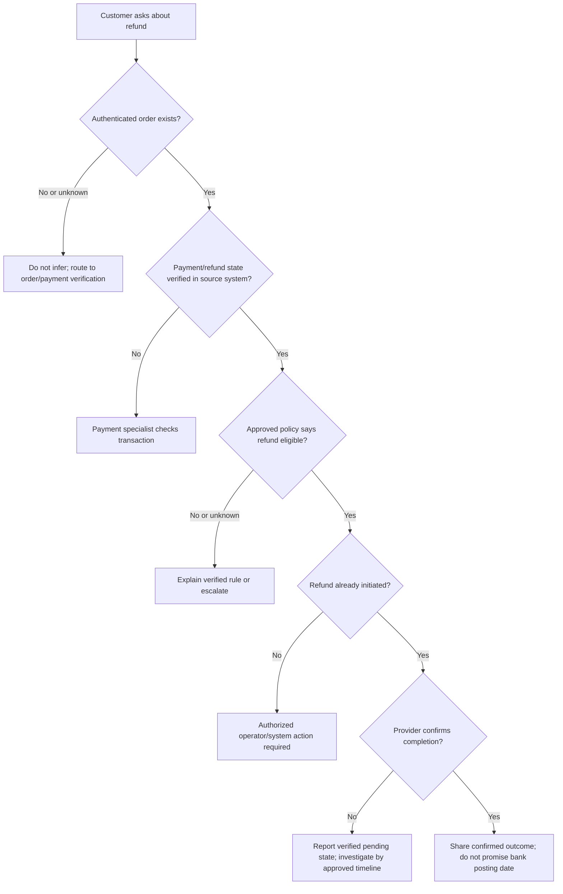
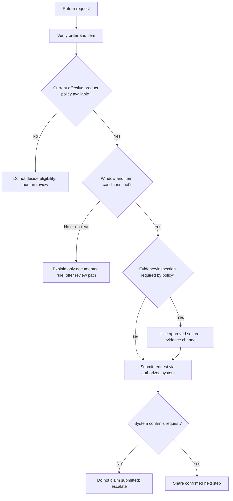
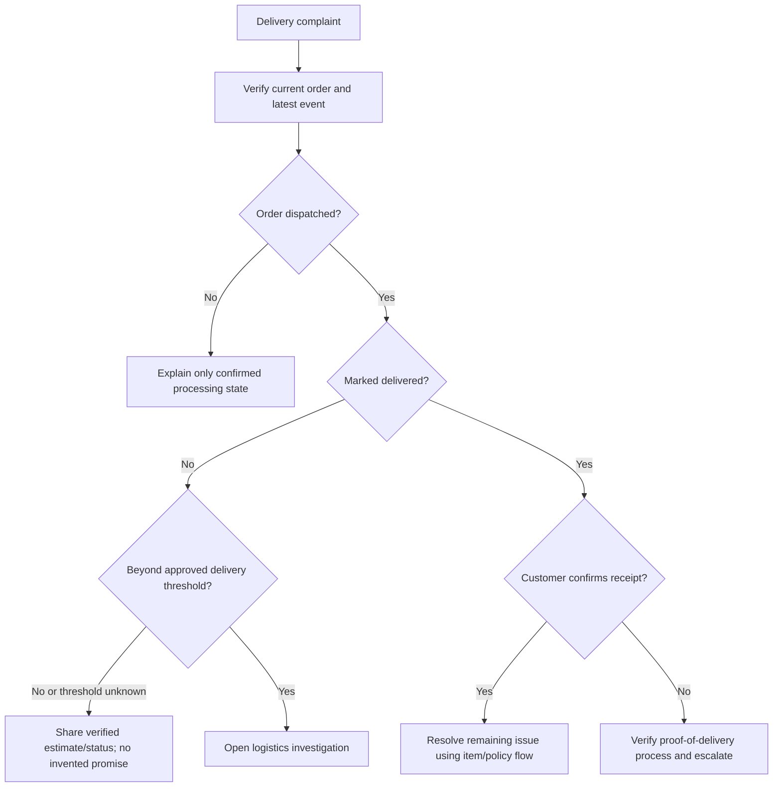

# Business Decision Trees

## Document metadata

| Field | Value |
|---|---|
| Document ID | `SHO-RULE-001` |
| Module / submodule | Operations / refund, return, delivery decisions |
| Document type / intent | Decision framework / triage |
| Customer segment / region / channel | Internal support guidance / `[COMPANY INPUT REQUIRED]` |
| Version / last updated / effective date | 1.0 / 2026-10-30 / `[COMPANY INPUT REQUIRED]` |
| Status / source | Generic verification trees; policy leaves intentionally unconfigured / project prompt |
| Related documents | `SHO-ORDER-001`, `SHO-PAY-001`, `SHO-RET-001`, `SHO-SHIP-001` |

## Refund triage

The actual eligibility criteria, processing timeline, provider state definitions, and escalation threshold are `[COMPANY INPUT REQUIRED]`.

## Return triage

## Delivery complaint triage

All time thresholds, proof rules, and resolution authority require company approval.
